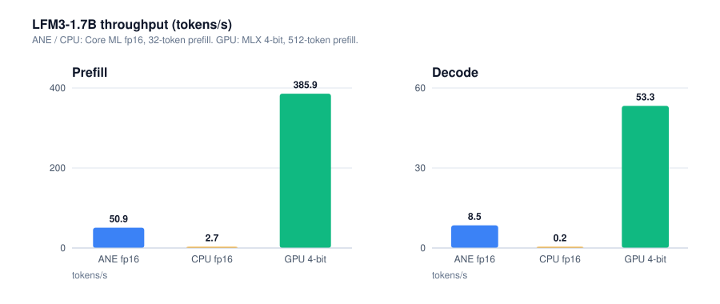
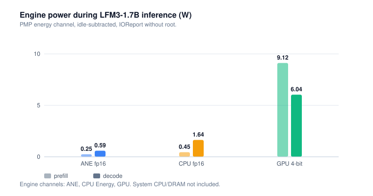

# LoNE benchmarks

Every number here was measured on a real machine, not quoted from a spec sheet. Two machines:

| | M1 Air | M4 Pro |
|---|---|---|
| memory | 8 GB | 24 GB |
| OS | macOS 26.6 | macOS 26.6.2 |
| LoNE | v0.1.1 | v0.0.1 (`4806171`) |
| source | this repo's development machine | issue [#1](https://github.com/AJ-Gonzalez/LoNE/issues/1), contributed by a user |

Power is the engine's PMP rail from IOReport, idle-subtracted, sampled at 100 ms over the decode
window — engine power, not wall power. Wall power adds CPU orchestration and DRAM; the M4 rows that
include those are marked "SoC+DRAM".

## Parity (`lone verify`)

| Bundle | Machine | Size | Logits cosine | Hidden min | Note |
|---|---|---:|---:|---:|---|
| fp16 | M1 | 4.0 GB | **0.99977** | 0.99958 | ctx 512, 4 layers/graph |
| fp16 | M4 Pro | 6.5 GB | 0.99978 | 0.99959 | ctx 1024, greedy diverges token 6 |
| LUT8 | M1 | 2.2 GB | 0.9985 | — | 57-token code prompt |
| LUT8 | M4 Pro | 3.5 GB | 0.99362 | 0.98337 | 12-token prompt, different from M1's |
| LUT6 | M1 | 1.8 GB | 0.9526 (0.9616 on the code prompt) | 0.9218 | below the 0.999 bar |
| LUT4 | M1 | 1.4 GB | 0.786 | 0.33 drift | not shippable |

Per-op conversion parity is much higher than end-to-end parity: LFM2.5 layers measure ≥0.99999,
LFM3 conv 0.99968, LFM3 attention ≥0.9999. `lone verify` exists because per-op numbers do not catch
the three fp16 arithmetic rules documented in the README.

## Throughput and energy





LFM3-1.7B, 128-token prompt, greedy decode. M1 rows are the instrumented window; M4 rows are the
mean of two runs.

| Engine | Weights | Machine | Prefill tok/s | Decode tok/s | Engine mJ/tok | SoC+DRAM mJ/tok |
|---|---|---:|---:|---:|---:|---:|
| ANE fp16 | 4.0 / 6.5 GB | M1 | 50.9 | 8.5 | 70 | — |
| ANE fp16 | 6.5 GB | M4 Pro | 1038 | 23.6 | 54 | 230 |
| ANE LUT8 | 2.2 / 3.5 GB | M1 | — | 23.1 | — | — |
| ANE LUT8 | 3.5 GB | M4 Pro | 1045 | 25.5 | 59 | 148 |
| CPU fp16 | 4.0 GB | M1 | 2.73 | 0.20 | 8200 | — |
| CPU fp16 | 6.5 GB | M4 Pro | 836 | 22.6\* | 371 | 462 |
| GPU MLX 4-bit | 0.95 GB | M1 | 385.9 | 53.3 | 113 | — |
| GPU MLX 4-bit | — | M4 Pro | 1261 | 178.5 | 77 | 117 |
| GPU MLX 8-bit | — | M4 Pro | 1122 | 109.2 | 117 | 173 |
| GPU MLX bf16 | — | M4 Pro | 989 | 62.6 | 175 | 272 |

\* Single 24-token run, ~1 s window; treat its power as rough.

Two readings that matter:

- **The ANE is the cheapest engine per token, not the cheapest system.** On M4, ANE LUT8 costs
  59 mJ/token on the engine rail but 148 mJ/token once CPU orchestration and DRAM are included,
  against 117 for MLX 4-bit — which also decodes 7× faster. At matched precision (fp16 ANE vs bf16
  MLX) the ANE is still ~15% lower, 230 vs 272.
- **LUT8 barely helps on M4 Pro** (+8%, 23.6 → 25.5 tok/s) while halving weight bytes; on M1 it was
  +75% (13.2 → 23.1). That points at fixed per-call cost on the newer chip, not weight bandwidth —
  a hypothesis, not a profile.

M1 LFM3 ANE decode varies **2–13 tok/s with weight residency** (8.5 instrumented, 13.2 warm, ~2
when the 4 GB stream from SSD), so always pair a rate with the power from the same window.

## Quantization on the ANE (M1)

All of these place every op on the NE; only fp16 meets the parity bar.

| Weights | Bundle | Decode tok/s | ANE power | Energy/token | Logits cosine |
|---|---:|---:|---:|---:|---:|
| fp16 | 4.0 GB | 13.2 warm | 0.59 W | 70 mJ | 0.99977 |
| LUT8 | 2.2 GB | 23.1 | — | — | 0.9985 |
| LUT6 | 1.8 GB | 20.5 | 0.87 W | 39 mJ | 0.9526 |
| LUT4 | 1.4 GB | 30.7 | 0.88 W | 37 mJ | 0.786 |

Each extra LUT bit buys ~0.04 logits cosine between 6 and 8 bits; 8-bit is the closest post-training
format to the bar, and 6-bit parity needs QAT. A 60 s sustained LUT6 run measured 23.7 tok/s at
1.04 W (43.9 mJ/token) with no throttling.

## Speculative decoding (n-gram)

`bench/spec_ab.py` runs both arms interleaved in one process after a warmup. A verify pass costs
**1.40×** a decode pass on the ANE (1.45× on Metal), so speedup tracks tokens/pass and break-even is
1.40 tokens/pass.

ANE, LFM3 coder LUT8, ctx 512, 16 drafts, 128 new tokens:

| workload | base tok/s | spec tok/s | speedup | acceptance | tokens/pass | energy (ANE rail) |
|---|---:|---:|---:|---:|---:|---:|
| repeat (raw, temp 0) | 23.2 | **84.4** | **3.64×** | 91.1% | **5.08** | 64.8 → 23.2 mJ/token |
| copy (chat, temp 0.1 / top_k 50) | 19.1 | 23.3 | 1.22× | 79.0% | 1.56 | 62.4 → 78.5 mJ/token |
| novel prose (chat, control) | 22.8 | 24.0 | 1.05× | 43.8% | — | 63.0 → 60.5 mJ/token |
| novel prose, before the empty-draft fix | 22.8 | 17.1 | 0.75× | 43.8% | 1.06 | 63.0 → 118.6 mJ/token |

Metal (llama.cpp, Q4_K_M, ctx 2048):

| workload | base tok/s | spec tok/s | speedup | tokens/step |
|---|---:|---:|---:|---:|
| copy (module re-emitted) | 37.7 | **66.9** | **1.77×** | 2.56 |
| novel prose (control) | 37.6 | 37.4 | 1.00× | 1.02 |
| repeat, chat-templated | 28.0 | 28.0 | 1.00× | 1.00 |

LFM2.5-230M, CPU path (mechanism check; the M1 planner declines 230M ANE graphs): 64.0 → 124.1
tok/s, **1.94×**, 93.8% acceptance, 1.88 tokens/pass, 96/96 greedy tokens identical.

Quality: speculation only changes which graph shape computes the logits. Greedy agreement between
arms was 128/128 on chat-copy, code and prose prompts, and 124/128 on the repeated-text workload,
where the first divergence was a 0.094-logit tie in fp16. Sampled decoding is exact rejection
sampling against a point-mass proposal, pinned by `tests/test_spec.py`.

## Conversion and load cost

| Artifact | Machine | Time |
|---|---|---:|
| LFM3-1.7B LUT8, ctx 256 | M1 | 513.6 s |
| LFM3-1.7B LUT6, ctx 256 | M1 | 390–435 s |
| LFM2.5-230M LUT6, ctx 128 | M1 | 57 s |
| ANE bundle load | M4 Pro | 25–35 s |
| MLX model load | M4 Pro | 1–2 s |

## Method and caveats

- **Engine, not wall.** IOReport engine rails, idle-subtracted. For system numbers add ~1.7 W CPU
  orchestration and ~0.9 W DRAM on M1; the M4 table's SoC+DRAM column is the author's `macmon`
  measurement.
- **The M4 Pro host was not quiet** — a dev server and a VM were running. Its author treats the
  absolute rates as indicative and the cross-engine ratios as the useful part.
- **Different quantizations are not directly comparable.** The M1 GPU row is 4-bit against fp16 ANE;
  the matched-precision comparison is fp16 ANE vs bf16 MLX.
- **Prompts differ between runs** (ctx 256 / 512 / 1024, 12 / 57 / 128 tokens). Parity in
  particular is prompt-sensitive; compare within a row, not across.
- **ANE placement is `MLComputePlan` over every chunk**, not a guess. The M1 planner declines the
  small LFM2.5 graphs, so those rows are CPU-path.

## Reproduce

```bash
lone convert --model <hf-or-mlx-dir> --out /tmp/bundle --ctx 512 --precision lut8
lone verify  --bundle /tmp/bundle
lone run     --bundle /tmp/bundle --prompt "..." --max-new-tokens 128
python bench/spec_ab.py --bundle /tmp/bundle --workload repeat --max-new-tokens 128
```
