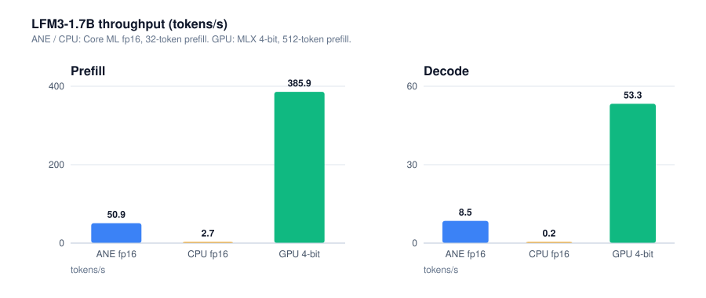
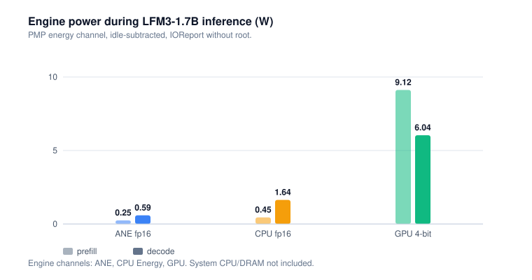

# LoNE: Liquid on Neural Engine

[](https://pypi.org/project/lone-ane/)
[](https://pypi.org/project/lone-ane/)
[](https://github.com/AJ-Gonzalez/LoNE/blob/main/LICENSE)

LFM3 and LFM2.5 on the Apple Neural Engine, via Core ML. Decode is bandwidth-bound on the ANE, so
LoNE targets MLX-class throughput at a lower power envelope; it also works around the ANE's fp16
arithmetic failures, which are the precision rules below.

## Install

Apple Silicon, macOS 15+, Python 3.11+. The distribution is **`lone-ane`** on
[PyPI](https://pypi.org/project/lone-ane/); it installs the **`lone`** command.

```bash
pip install lone-ane                  # run / serve / chat
pip install 'lone-ane[convert,chat]'  # conversion + HF chat templates
```

For a development checkout: `uv venv && source .venv/bin/activate && uv pip install -e '.[convert,chat]'`.

`convert` adds torch 2.7.0 and scikit-learn (coremltools' k-means palettizer); `chat` adds
transformers for exact chat-template rendering — `lone chat` works without it, using the bundled
Jinja template.

## Homebrew

```bash
brew tap aj-gonzalez/lone https://github.com/AJ-Gonzalez/LoNE
brew trust aj-gonzalez/lone
brew install lone-ane
```

Builds the released source tag (`v0.1.1`) into an isolated Python 3.12 venv with runtime
dependencies from PyPI. Conversion extras are opt-in:

```bash
"$(brew --prefix lone-ane)/libexec/bin/pip" install "torch==2.7.0" "scikit-learn>=1.4,<1.6" "transformers>=5.0"
```

## Quick start

```bash
lone convert --model /path/to/LFM3-1.7B --out bundles/lfm3-1.7b --ctx 2048 --prefill 64
lone run --bundle bundles/lfm3-1.7b --chat --prompt "Explain RoPE in two sentences" --max-new-tokens 128
lone chat --bundle bundles/lfm3-1.7b
lone serve --bundle bundles/lfm3-1.7b --port 8082
lone inspect --bundle bundles/lfm3-1.7b
lone verify --bundle bundles/lfm3-1.7b --model /path/to/LFM3-1.7B \
    --prompt "Explain in one sentence why the sky is blue."
```

Convert flags: `--precision fp16|lut4|lut6|lut8`, `--layers-per-model 4`, `--head-chunks` (0 sizes
each head graph to ~128 MB), `--decode-only`/`--prefill-only`, `--ring/--no-ring`, `--no-plan`,
`--spec-drafts N` (adds the verify shape; see below).
Weights are stored once per sequence shape, so a full bundle is ~2x the fp16 checkpoint;
`--decode-only` halves it. `--no-ring` keeps a full-`ctx` cache for sliding layers.

`lone verify` runs the HF checkpoint in a subprocess, then the bundle's decode path in the parent,
printing logits cosine, argmax, per-layer hidden drift and (with `--max-new-tokens`) the first greedy
divergence. It exits 1 below `--min-cos` (default 0.999). Run it before trusting a conversion.

## Chat

```bash
lone chat --bundle bundles/lfm3-1.7b --system "Be terse."
```

One process, one stats block per turn (measured on the 230M bundle):

```
you> Hi
lone> Hello! How can I help you today
  prefill 11 tok 0.10 s 104.8 tok/s 0.97 W · decode 5 tok 0.08 s 66.6 tok/s 0.73 W
  ctx 17/128 (13.3%) · mem 0.59 GB rss · 0.07 GB free · ane io 11.15 GB
```

Prefill is measured until the first sampled token (the `/metrics` convention), decode after it.
`ctx` counts the tokens held; `mem` is process RSS and system free memory; the watts are the ANE rail
from the `PMP` group — cumulative, system-wide counters, so short turns are noisy; `ane io` is ANE
read+write traffic. History is fed incrementally — each turn prefills only the tokens the template
added — and `/reset` clears the conversation while keeping the weights loaded, which is the point of
a REPL here: a fresh process re-specialises every graph (8 s measured for the 230M bundle).

## Speculative decoding

```bash
lone convert --model /path/to/LFM3-1.7B --out bundles/lfm3-1.7b-spec \
    --ctx 512 --precision lut8 --spec-drafts 16
lone run --bundle bundles/lfm3-1.7b-spec --spec-ngram --max-new-tokens 128 --prompt "..."
```

Decode is bandwidth-bound here: one token re-reads the whole stack, so 16 tokens cost about the
same as one when they go through a single graph. `--spec-drafts 16` converts that graph — the
prefill shape becomes 17 tokens (one pending token plus 16 drafts) and the LM head is traced at the
same length, so a verify pass returns one logits row per position from one weight read.

The proposer is llama.cpp's `ngram-simple`, reimplemented verbatim (`src/lone/spec.py`): rescans the
token history for the most recent earlier occurrence of the last `--spec-n` (12) tokens and drafts
the following `--spec-m` (16) tokens, with llama.cpp's quirks — needs `n + m + 1` tokens of history,
ignores a match at position 0, drops drafts shorter than `n`. It is a copy engine, so it only pays
on repeated text (editing, refactoring, copying a file); on prose it drafts nothing and costs
nothing.

Acceptance is exact, not greedy-only: a draft token is accepted with the target's own probability
for it and a rejected position draws from the target minus that token, so `--temperature`/`--top-k`/
`--top-p` keep their distribution. At temperature 0 the accepted sequence is what plain greedy
decode produces, except where the two graph shapes disagree on a near-tie: measured 0.9999 logits
cosine between them, 96/96 identical tokens on a 230M copy test, 124/128 (96.9%) on the LUT8 1.7B.

Quality is unchanged: speculation only changes which graph shape computes the logits, and the
accept rule is exact rejection sampling, so sampled output keeps the target distribution. Greedy,
128 new tokens, LUT8 coder on the NE, both arms on the same prompt: **identical** on a chat copy
request, a code task and prose; 124/128 on the repeated-text workload, where the one divergence sits
on a 0.09-logit top-2 margin (a tie in fp16) and everything after it differs.

Measured (this M1, one process, both arms interleaved after a warmup; rates exclude prefill):

| Bundle, engine | Workload | No spec | Spec | Acceptance | Tokens/pass |
|---|---|---:|---:|---:|---:|
| LFM2.5-230M fp16, ctx 256, 4 drafts, CPU | copy, temp 0 | 64.0 tok/s | 124.1 tok/s (1.94×) | 93.8% | 1.88 |
| LFM3-1.7B LUT8 coder, ctx 512, 16 drafts, **NE** | repeat, temp 0 | 23.2 tok/s | **84.4 tok/s (3.64×)** | 91.1% | 5.08 |
| same | copy (chat turn), temp 0.1 | 19.1 tok/s | 23.3 tok/s (1.22×) | 79.0% | 1.56 |
| same | novel prose (control) | 22.8 tok/s | 24.0 tok/s (1.05×) | 43.8% | — |

One verify pass costs 1.40 decode passes on the NE (1.45 on Metal), so break-even is 1.40
tokens/pass and the speedup tracks how much verbatim text the model emits. On the ANE the repeat
workload also drops from 64.8 to 23.2 mJ/token on the engine rail; a workload the proposer cannot
exploit costs about 5%, and energy per token there was 63.0 → 60.5 mJ.

Partial acceptance rewinds the caches to the accepted prefix. K/V rows are written at absolute
positions and the mask admits nothing at or past `pos`, so stale rows are overwritten by the next
pass; conv layers get their window from an extra graph output (`conv_<i>_window`, the previous
window concatenated with this pass's inputs), which makes any prefix of the pass addressable.

## Serve

```bash
curl -s localhost:8082/v1/chat/completions -H 'Content-Type: application/json' -d '{
  "model": "lfm3-1.7b",
  "messages": [{"role": "user", "content": "Hi"}],
  "max_tokens": 64
}'
```

| Endpoint | Notes |
|---|---|
| `POST /v1/chat/completions` | OpenAI chat schema, SSE when `stream: true` |
| `POST /v1/completions` | raw prompt, SSE when `stream: true` |
| `GET /v1/models`, `/health` | harness probes |
| `GET /metrics` | prefill/decode seconds and rates, last-request ANE bytes (IOReport; streams included) |

One request at a time; Core ML serialises predictions anyway. `--cpu-only` and
`--compute-units {cpu_and_ne,cpu_and_gpu,cpu_only,all}` select the engine. Point EvalPlus
(`--backend openai`), lm-eval (`local-chat-completions`) or Harbor at the OpenAI endpoint.

## Precision rules

The ANE's arithmetic differs from torch's fp16 in three measurable ways; `torch_model` implements
all three, and `lone verify` exists because per-op conversion parity does not catch them.

| Rule | Why (measured) |
|---|---|
| **Wide reductions split** (FFN > 4096, head hidden > 1024) | one 6656-wide projection 0.9972; two 3328-wide 0.999994 |
| **Wide reductions scaled by 2^4** (any k > 1024; weights ×16, output ×1/16) | products otherwise fall subnormal: LFM3 conv `out_proj` 0.99916 → 0.9999998 |
| **SiLU as `x / (1 + exp(-x))`** | Core ML's fused `silu`/`sigmoid` is an NE approximation ~1e-3 off; gate 0.99935 → 0.999991 |

Power-of-two scaling is exact in fp16 unless it overflows; 2^4 stays far below the maximum. Norm
reductions need none of this — `mean` over 2048 measured exact on the ANE.

Chunk size is not a precision knob once those rules are in place: 230M measures 0.99981 (1 layer),
0.99976 (2) and 0.99990 (4) at ctx 128; LFM3-1.7B measures 0.99977 at 4. The old 0.9968 / 0.9969
readings predate the scaled reductions and exact SiLU. Fewer graphs are also cheaper — each pays a
start-up ramp — worth 1.58× on 230M (17.6 → 11.1 ms/token) and inside noise on LFM3.

## Measured (M1, 8 GB)

Parity (`lone verify`, decode path):

| Model | Placement | Logits cosine | Notes |
|---|---|---:|---|
| LFM2.5-230M (ctx 128) | CPU | 0.99987 | greedy 2 tokens identical, then EOS differs |
| LFM2.5-350M (ctx 128) | CPU | 0.99989 | greedy 12/12 identical |
| LFM3-1.7B (ctx 512, 4 layers/graph) | NE | **0.99977** | hidden min 0.99958; argmax match |

Placement is `MLComputePlan` over every chunk. The M1 planner declines the small LFM2.5 graphs, so
only LFM3 runs on the NE here; those rows are CPU-path parity.

Speeds and power by engine. Power is the engine's PMP rail, idle-subtracted, via IOReport without
root; rate and power come from the same window.

| Engine | Weights | Prefill tok/s | Decode tok/s | Prefill power | Decode power | J/token (decode) |
|---|---|---:|---:|---:|---:|---:|
| ANE (`CPU_AND_NE`) | fp16, 4.0 GB | 50.9 (32 tok) | 8.5 | 0.25 W | 0.59 W | 0.070 |
| CPU (`CPU_ONLY`) | fp16, 4.0 GB | 2.73 (32 tok) | 0.20 | 0.45 W | 1.64 W | 8.2 |
| GPU (MLX 4-bit, Metal) | 4-bit, 0.95 GB | 385.9 (512 tok) | 53.3 | 9.12 W | 6.04 W | 0.113 |





Engine numbers, not wall power: decode adds ~1.7 W of CPU orchestration and ~0.9 W of DRAM; the CPU
row's work power is 2.82 W. The GPU row is 4-bit while ANE/CPU are fp16, so it is not
quantization-controlled. LFM3 ANE decode varies **2–13 tok/s** with weight residency (8.5 in the
instrumented window, 13.2 warm, ~2 when 4 GB stream from SSD), so pair rate and power from one run.
`CPU_AND_GPU` is not a GPU path: 0.51 tok/s at 0.07 W.

Quantized ANE (LFM3-1.7B) — all place every op on the NE; none meets the fp16 parity bar:

| Weights | Bundle | Decode | ANE power | Energy/token | Logits cosine |
|---|---:|---:|---:|---:|---:|
| fp16 | 4.0 GB | 13.2 tok/s | 0.59 W | 0.070 J | 0.99977 |
| LUT8 | 2.2 GB | 23.1 tok/s | — | — | 0.9985 |
| LUT6 | 1.8 GB | 20.5 tok/s | 0.87 W | 0.039 J | 0.9526 |
| LUT4 | 1.4 GB | 30.7 tok/s | 0.88 W | 0.037 J | 0.786 |

\* LUT8's parity is from a 57-token code prompt (LUT6 measures 0.9616 there); other rows use an
earlier, shorter prompt. Power for 8-bit weights is not measured.

Each extra LUT bit buys ~0.04 logits cosine in the 6–8 range; 8-bit is the only format near the
bar, and 6-bit parity needs QAT. Those power figures are 1–2.5 s window averages; a 60 s sustained
LUT6 run measured 23.7 tok/s at 1.04 W (43.9 mJ/token) with no throttling, and ~3.7 W system-wide
with CPU and DRAM. A wall/package figure needs `powermetrics` (root) or a meter.

## Limits

- **Static shapes.** `ctx` and prefill length are frozen at conversion; prompt remainders decode one
  token at a time. Caches are allocated at load: `ctx` rows for full-attention layers, the window for
  sliding ones. LFM3 costs 22.5 KB per context token before the ring, so 32k allocates 0.40 GB of
  cache instead of 0.74 (64k: 0.81 vs 1.5; 128k: 1.6 vs 2.9). 32k fits on 8 GB; 128k is
  swap-bound `[INFERENCE]` — the longest measured run is a 401-token verification at ctx 512. `--wire-caches` (run, chat, serve) pins caches with `mlock(2)`
  so pressure evicts the mmap-backed weights instead.
- **fp16 / palettized only.** No fp32 ANE path; palettized weights trade accuracy (above).
- **Speculation stores a second copy of the weights.** `--spec-drafts N` sets the prefill shape to
  N+1, and LoNE stores weights once per sequence shape, so the chunks double. A 1.7B LUT8 bundle
  with a verify shape is 4.4 GB (loads on 8 GB); the fp16 equivalent is 8 GB and does not.
- **One request, no batching**; no left-padded prompts.
- **Prefill models load lazily**, decode models at startup; a full bundle stores both shapes.
- **Not implemented:** tools/structured output, `logit_bias`, `n`, `logprobs`; `stop` strings apply
  to the decoded text after generation. Sharded checkpoints are unsupported.
- **Depth costs accuracy.** LFM3's hidden cosine falls 0.999995 → 0.99958 over 24 layers; at 1 layer
  per graph, greedy output diverged from HF after 6 tokens (ctx 256) despite 0.99977 logits cosine.

## How it works

The stack is split into contiguous chunks, one `mlprogram` per sequence shape (prefill and decode).
Caches are ordinary tensors owned by the runtime — K/V per attention layer and the
`conv_kernel-1` window per conv layer — concatenated as `past || new` inside the graph with an
additive mask keyed by absolute position. No Core ML state buffers, so conversion stays on
TorchScript. The LM head is vocabulary slices on the ANE; the embedding gather runs on the CPU.

Sliding layers keep a **ring buffer** sized to their window (256 for LFM3) instead of `ctx`: row
`p % window` holds absolute position `p`, the runtime writes new keys there, and the mask resolves
rows back to positions, so the graph reads 256 keys where it used to read `ctx`. Same attention,
only the rotation changes; `--no-ring` restores the full-`ctx` cache. Verified through the wrap
(401-token prompt, ctx 512): 0.99991 logits cosine, argmax match.

## Notes and unverified ideas

External suggestions not yet measured — LUT4 + pruning + retraining, and emitting the MIL graph
directly in Swift: [`docs/notes.md`](docs/notes.md).
